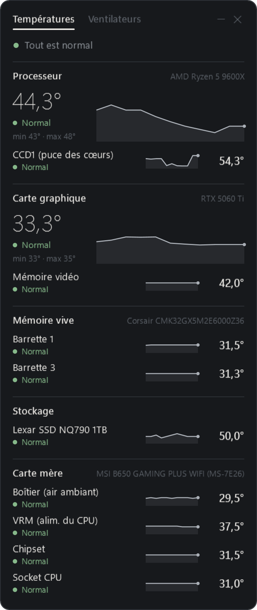
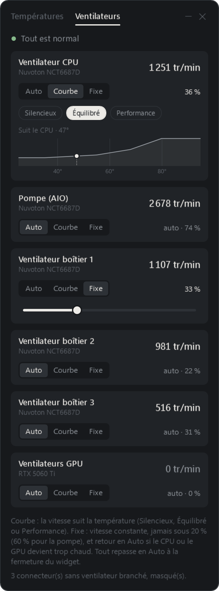

<p align="center">
  
</p>

<h1 align="center">Strix Monitor</h1>

<p align="center">
  <b>Your PC's temperatures, live, with what's normal… and what isn't.</b><br>
  CPU, GPU, RAM, SSD, motherboard and fans, in a small Windows widget that keeps watch like an owl.
</p>

<p align="center">
  <a href="README.md">Français</a> · <b>English</b>
</p>

---

Strix Monitor shows the **exact temperature of every important component** and tells you, for each one, whether it is **normal, worth watching or too hot**, using thresholds that fit that component. It also lets you **control your fans** (curves or fixed speed) and **record a session** to analyse your PC during a benchmark or a game.

> **100 % local.** No account, no server, no telemetry: nothing leaves your PC.
> The only Internet connection happens during setup, and only if you ask for it: the PawnIO driver is downloaded from its official page and its checksum is verified before it is installed.

<p align="center">
  
  
</p>

The interface is in French for now.

## Features

- Live temperatures for the CPU (and its dies), GPU (core, memory), each RAM stick, SSDs and motherboard sensors.
- A **Normal / Watch / Too hot** status per component, with a tooltip explaining what's normal.
- **Taskbar readout**: CPU on top, GPU below, updated in place; hides itself when a full-screen game runs on that screen.
- **Fans**: Auto, Curve (Quiet, Balanced, Performance) or Fixed, with safety limits (never below 20 %, back to Auto when things get too hot or when the app closes).
- **Recording sessions**: one sample per second of temperatures, fans, CPU/GPU load and power, then a detailed analysis with min / average / max.

## Install

1. Download **`StrixMonitor-Setup.zip`** from the [latest release](https://github.com/nodyxstudio/strix-monitor/releases/latest) and extract it.
2. Run **`StrixMonitor-Setup.exe`**, accept the admin prompt, click **Installer**. PawnIO is installed automatically if needed.

The exe is not code-signed: SmartScreen may warn you ("More info" → "Run anyway"). With Smart App Control enabled, Windows may block it; you can build it yourself instead:

```bash
dotnet publish src/StrixMonitor/StrixMonitor.csproj -c Release -o publish
```

## Credits

Sensor reading by [LibreHardwareMonitor](https://github.com/LibreHardwareMonitor/LibreHardwareMonitor), hardware access by [PawnIO](https://pawnio.eu). See [THIRD-PARTY-NOTICES.md](THIRD-PARTY-NOTICES.md).

Strix Monitor is released under the [MIT license](LICENSE).
