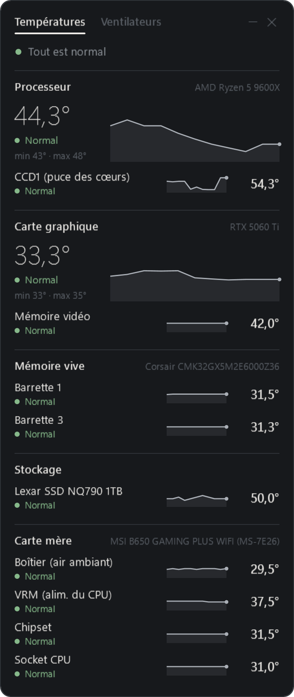
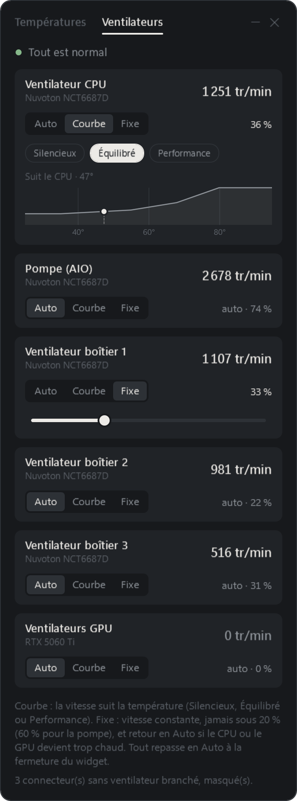
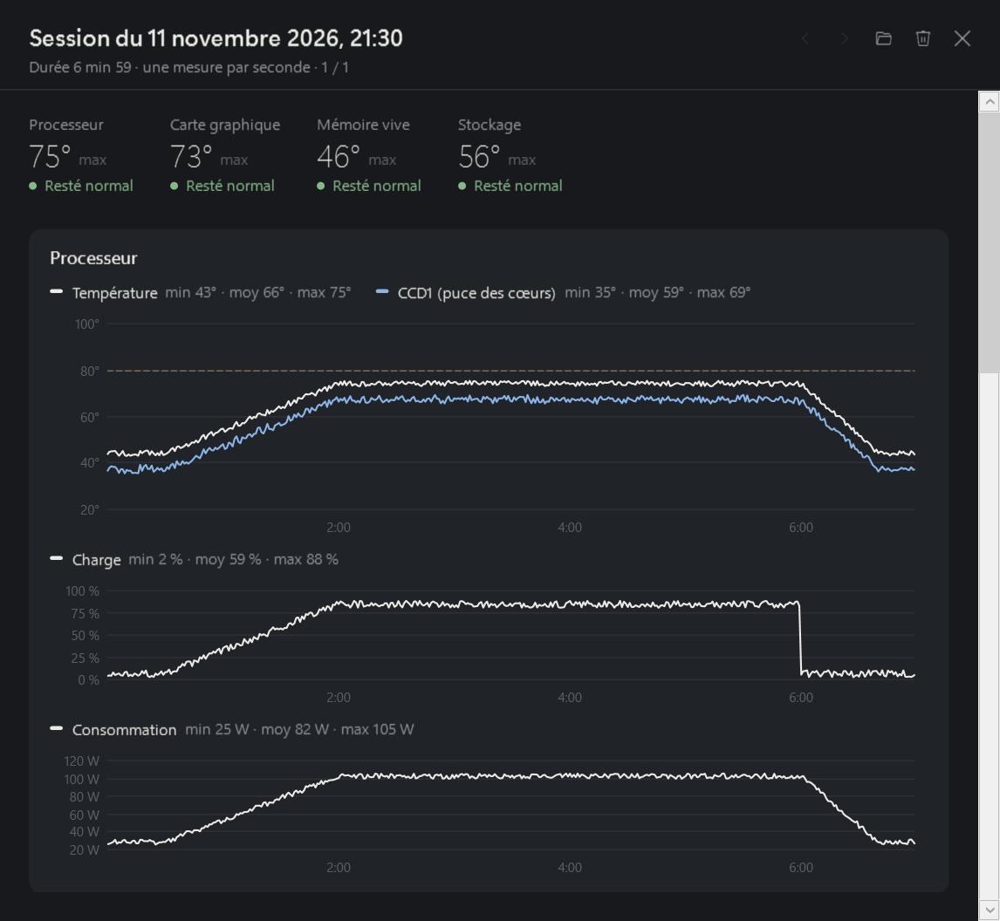
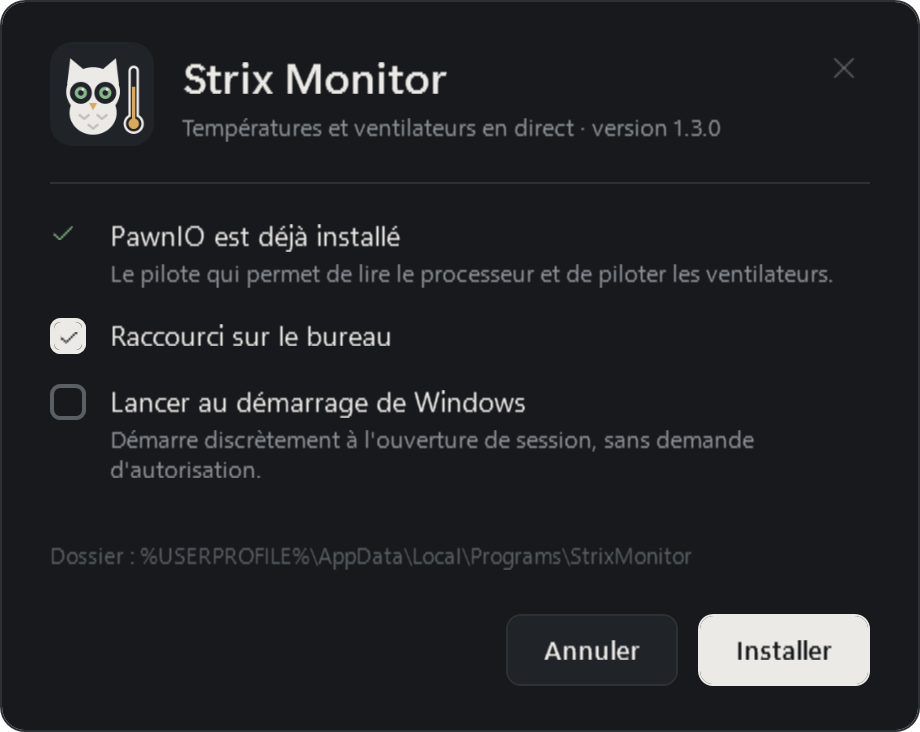

<p align="center">
  
</p>

<h1 align="center">Strix Monitor</h1>

<p align="center">
  <b>Les températures de ton PC en direct, avec ce qui est normal… ou pas.</b><br>
  Processeur, carte graphique, RAM, SSD, carte mère et ventilateurs, dans un petit widget Windows qui veille comme une chouette.
</p>

<p align="center">
  <a href="https://github.com/nodyxstudio/strix-monitor/releases/latest"></a>
  
  
  <a href="LICENSE"></a>
</p>

<p align="center">
  <b>Français</b> · <a href="README.en.md">English</a>
</p>

---

Strix Monitor affiche la **température exacte de chaque composant important** et te dit, pour chacun, si c'est **normal, à surveiller ou trop chaud**. Un CPU à 75 °C en jeu, c'est normal ; de l'air à 75 °C dans le boîtier, non : les seuils sont propres à chaque composant.

Il permet aussi de **piloter les ventilateurs** (courbes ou vitesse fixe) et d'**enregistrer une session** pour analyser ton PC pendant un benchmark ou une partie.

> **100 % local.** Pas de compte, pas de serveur, pas de télémétrie : rien ne sort de ton PC.
> La seule connexion à Internet a lieu pendant l'installation, et seulement si tu la demandes : le pilote PawnIO est téléchargé depuis sa page officielle, puis son empreinte est vérifiée avant d'être installé.

<p align="center">
  
  
</p>

## Ce qu'il fait

- **Températures en direct** du processeur (et de ses puces), de la carte graphique (cœur, mémoire vidéo), de chaque barrette de RAM, des SSD et des sondes de la carte mère (boîtier, VRM, chipset, socket).
- **« Normal », « À surveiller » ou « Trop chaud »**, avec des seuils adaptés à chaque composant. Au survol, une bulle explique ce qui est normal (« Ryzen : 40–55 °C au repos, jusqu'à 80 °C en charge… »).
- **Courbes des 2 dernières minutes** et minimum / maximum depuis le lancement.
- **Encart dans la barre des tâches** : CPU en haut, GPU en bas, mis à jour sur place. Un clic affiche ou cache le widget. Il se cache tout seul quand un jeu est en plein écran sur le même écran.
- **Ventilateurs** : vitesse en tr/min, et trois modes :
  - **Auto** : le BIOS (ou la carte graphique) décide, comme d'habitude ;
  - **Courbe** : Silencieux, Équilibré ou Performance, la vitesse suit la température du CPU, du GPU ou du plus chaud des deux ;
  - **Fixe** : un pourcentage constant.
- **Sessions d'enregistrement** pour un benchmark ou une partie (voir plus bas).
- **Installation en un clic**, raccourcis, démarrage avec Windows en option, désinstallation propre depuis « Applications installées ».

## Dans la barre des tâches

Un petit encart reste toujours visible à côté de l'horloge, avec la température du CPU et du GPU. Les chiffres passent en orange ou en rouge si ça chauffe. Tu peux le faire glisser pour le placer où tu veux ; un clic droit le remet à sa place.

## Enregistrer une session

Un clic sur **●** dans le widget lance l'enregistrement : une mesure par seconde de toutes les températures, des ventilateurs, de la **charge (%)** et de la **consommation (W)** du CPU et du GPU. Un clic sur **■** l'arrête et ouvre l'analyse :

<p align="center">
  
</p>

- le pic de chaque composant, et s'il est resté dans la zone normale ;
- une courbe par composant, avec minimum, moyenne et maximum ;
- la valeur exacte de chaque courbe au survol de la souris.

Les sessions sont de simples fichiers CSV, faciles à ouvrir dans un tableur. Elles s'arrêtent seules au bout de 3 h.

<sub>Capture faite avec une session de démonstration.</sub>

## Installation

1. Télécharge **`StrixMonitor-Setup.zip`** dans la [dernière version](https://github.com/nodyxstudio/strix-monitor/releases/latest), puis extrais-le.
2. Lance **`StrixMonitor-Setup.exe`** et accepte la demande d'autorisation.
3. Clique **Installer**. Si le pilote PawnIO n'est pas encore là, il est téléchargé et installé automatiquement.

<p align="center">
  
</p>

**À savoir :**

- L'exe n'est **pas signé** (un certificat coûte cher pour un petit projet). Windows peut afficher « Windows a protégé votre ordinateur » : clique **Informations complémentaires**, puis **Exécuter quand même**.
- Si **Smart App Control** est activé sur ton PC, Windows peut bloquer l'exe sans proposer de le lancer. Tu peux alors compiler l'app toi-même (voir plus bas).
- L'app demande les **droits administrateur** à chaque lancement : c'est obligatoire pour lire les sondes du processeur et piloter les ventilateurs. Avec « Lancer au démarrage de Windows », elle démarre sans rien demander.

## Ventilateurs : les sécurités

Toucher aux ventilateurs n'est jamais anodin, donc :

- en mode **Fixe**, la vitesse ne descend jamais sous **20 %** (60 % pour une pompe de watercooling) ;
- si le CPU ou le GPU devient **trop chaud**, les ventilateurs en mode Fixe repassent **immédiatement en Auto** ;
- en mode **Courbe**, la vitesse monte d'un coup quand ça chauffe et redescend doucement ; si une sonde disparaît, la main revient au BIOS ;
- à la **fermeture** de l'app, tous les ventilateurs repassent en **Auto**.

Le contrôle dépend de la carte mère : sur certaines, les ventilateurs s'affichent en « lecture seule ».

## Où sont tes données

Tout reste dans ton dossier utilisateur :

| Quoi | Où |
|---|---|
| L'application | `%LOCALAPPDATA%\Programs\StrixMonitor` |
| Réglages, sessions, journal d'erreurs | `%APPDATA%\StrixMonitor` |

La désinstallation supprime les deux. Le pilote PawnIO reste installé, car d'autres logiciels peuvent s'en servir ; il se désinstalle à part.

## Compiler soi-même

Il faut le [SDK .NET 8](https://dotnet.microsoft.com/download/dotnet/8.0).

```bash
git clone https://github.com/nodyxstudio/strix-monitor.git
cd strix-monitor
dotnet publish src/StrixMonitor/StrixMonitor.csproj -c Release -o publish
```

Le résultat est un seul fichier, `publish/StrixMonitor.exe`, qui contient tout ce qu'il faut (pas besoin d'installer .NET pour le lancer).

## Merci à

- [LibreHardwareMonitor](https://github.com/LibreHardwareMonitor/LibreHardwareMonitor), qui fait tout le travail de lecture des capteurs ;
- [PawnIO](https://pawnio.eu), le pilote qui lui donne accès au matériel.

Le détail des licences est dans [THIRD-PARTY-NOTICES.md](THIRD-PARTY-NOTICES.md).

---

**Ton avis m'intéresse.** C'est un projet d'apprentissage : les critiques sont bienvenues, tant qu'elles aident à progresser. Un bug, une idée, une carte mère qui n'est pas reconnue ? Ouvre une [issue](https://github.com/nodyxstudio/strix-monitor/issues).

Strix Monitor est sous licence [MIT](LICENSE).
